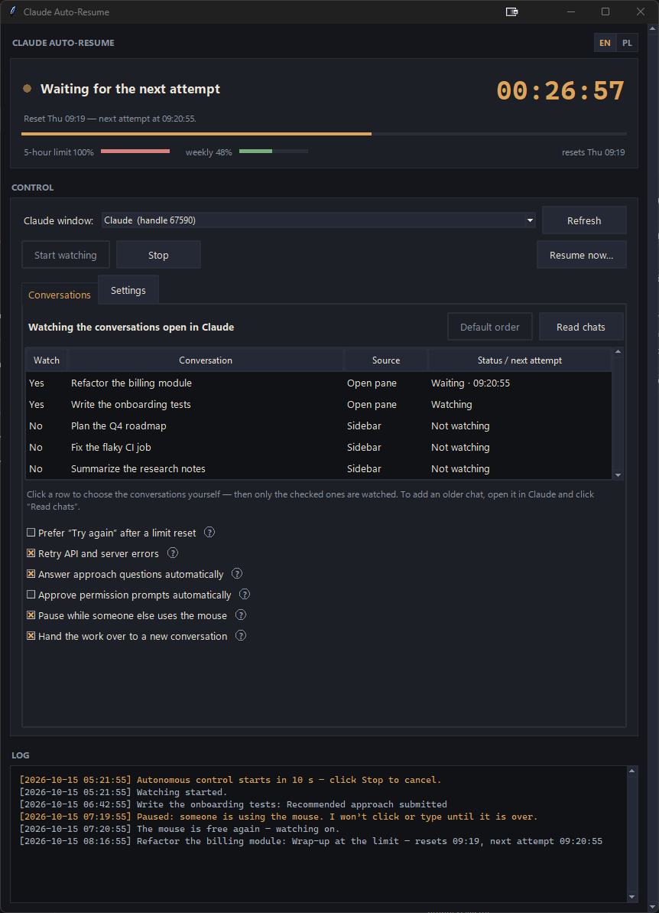
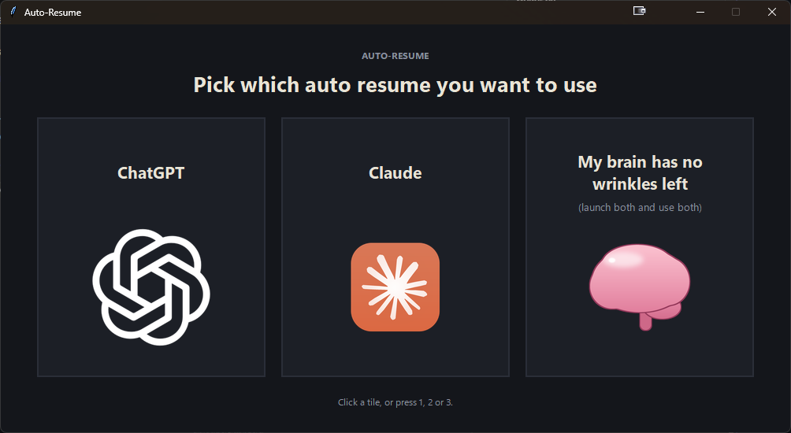
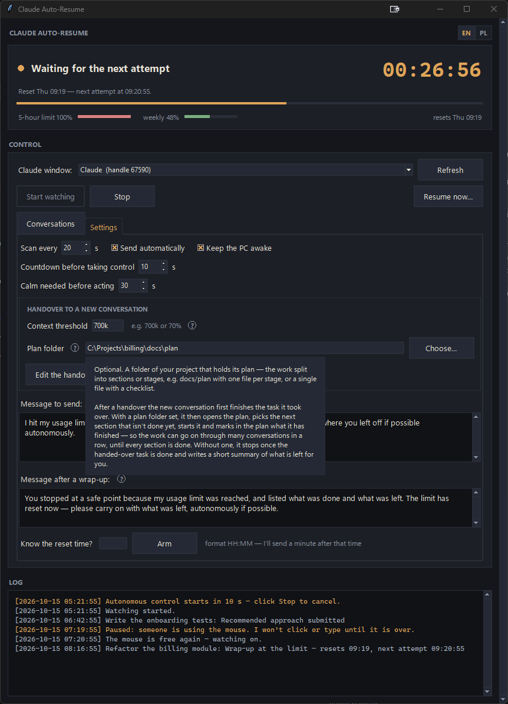
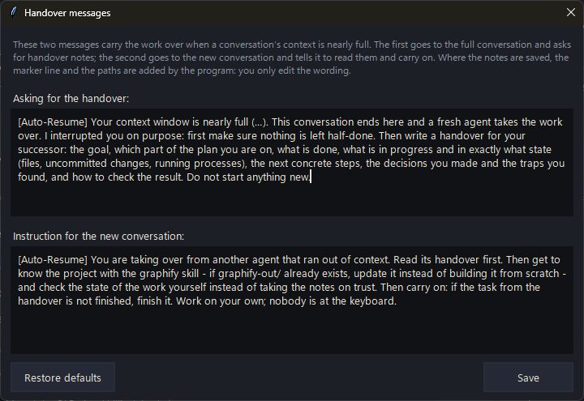
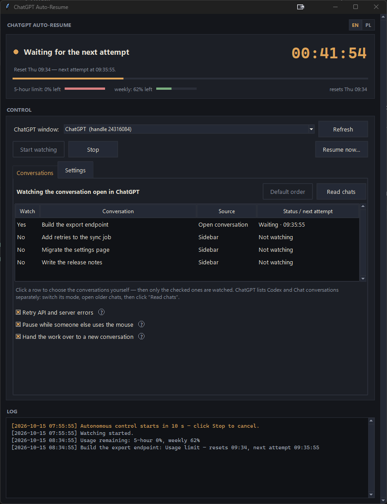

# Claude & ChatGPT Desktop App Auto-Resume for Windows 11

**Don't let the 5-hour limit stop Claude — or ChatGPT — in the middle of an overnight run.**

When the usage limit runs out in the **Claude** or **ChatGPT** desktop app, the work
stops until you type "continue" yourself. This tool watches the app for you: it sees the
limit, finds out when it resets and, **one minute after the reset, tells the agent to
carry on**. You can leave it running overnight.

It reads the apps like a screen reader (no screenshots, no API key), runs only on your
PC, and speaks English and Polish (the EN/PL switch in the top-right corner). It is the
Windows-desktop counterpart of the Linux terminal tool `claude-auto-retry`.



*The screenshots show sample conversations.*

---

## What it does

- **Resumes after a limit.** It spots Claude's *"Session limit reached"* card or
  *"Usage limit reached"* strip and ChatGPT's *"You've hit your usage limit"*, finds the
  reset time and, a minute after the reset, sends your message (or clicks **Try again**).
- **Watches many conversations**, split views included, each with its own timer.
- **Never types blindly.** It skips a chat that is still blocked, still working or holds
  your unsent draft, and types only when the right window is in front.
- **Holds still** while you, Claude's computer-use tools or ChatGPT are using the mouse.
- **Keeps the PC awake** while it waits.
- **Optional extras:** retry API errors, answer Claude's questions, approve permission
  prompts, accept the next step, start suggested sessions, and hand the work over to a
  new conversation when the context fills up.
- **Claude and ChatGPT side by side.** The two take turns at the keyboard.

---

## Install

You need **Windows 10 or 11**, **Python 3.10+** (check with `py --version`; get it from
[python.org](https://www.python.org/downloads/)) and the **Claude** and/or **ChatGPT**
desktop app, signed in.

```powershell
git clone https://github.com/MichalCholajczyk/claude_and_chatgpt-desktop-auto-resume.git
cd claude_and_chatgpt-desktop-auto-resume
```

Double-click **`Main.bat`**. It installs the one package it needs (`uiautomation`) and
opens the picker:

| Tile | Starts |
|---|---|
| **ChatGPT** | ChatGPT Auto-Resume |
| **Claude** | Claude Auto-Resume |
| **My brain has no wrinkles left** | both, side by side |



Click a tile or press **1**, **2** or **3**. If that program is already open, its window
comes forward instead. `run.bat` starts Claude Auto-Resume straight away. By hand:

```powershell
py -m pip install --user uiautomation
py app/launcher.py                 # the picker
py app/claude_auto_continue.py     # Claude Auto-Resume
py app/chatgpt_auto_continue.py    # ChatGPT Auto-Resume
```

---

## First run

1. Open **Claude** and the conversations you want to keep going.
2. Start the tool: `Main.bat` → **Claude**, or `run.bat`.
3. Check the **Claude window** field at the top. **Refresh** reloads the windows and the
   conversations.
4. On the **Conversations** tab click **Read chats**. With nothing checked, the tool
   watches the conversations open in Claude (*Watch: Yes*). Click rows to watch exactly
   those instead.
5. On the **Settings** tab set your message and pick the extras you want. The **?** next
   to each option explains it.
6. Click **Start watching**. A 10-second countdown gives you time to let go of the mouse;
   **Stop** cancels.

A green lamp means it is watching. The clock counts down to the next attempt and the list
shows each conversation's status (click a column header to sort it).

- **Resume now…** resumes every watched conversation at once.
- **Know the reset time?** If the tool can't read it, type it (`HH:MM`) and click
  **Arm**. Timers are not saved when you close the tool.

---

## Settings

Everything is in the app window and saved to `auto_continue_config.json`, beside
`Main.bat`.

| Option | Default | What it does |
|---|---|---|
| Message to send | *I hit my usage limit while you were working, but it has reset now. Please continue from where you left off if possible autonomously.* | sent after the reset and by **Resume now…** (blank = default) |
| Message after a wrap-up | *You stopped at a safe point because my usage limit was reached, and listed what was done and what was left. The limit has reset now — please carry on with what was left, autonomously if possible.* | sent instead when Claude [wrapped up](#wrap-up) at the limit |
| Prefer “Try again” after a limit reset | Off | click Claude's **Try again** instead of sending the message |
| Retry API and server errors | On | after a server error click **Try again** or send the message: up to 6 times, 30 s to 15 min apart, then **Needs attention** |
| Answer approach questions automatically | Off | pick the answers marked *Recommended*; with none, ask Claude to choose |
| Approve permission prompts automatically | Off | click **Always allow** (or **Allow once**), never **Deny** |
| Accept the next step automatically | Off | click the main button of the box a turn ends with (*"Yes, go ahead"*), never *Commit*, *Create PR*, *Merge* or *Archive* |
| Answer suggested new sessions automatically | Off, *Start* | answer a new-session card with *Start* or *Do it here*; at most 5 new sessions per run |
| Hand the work over to a new conversation | Off | see [Handover](#handover-when-the-context-fills-up) |
| Pause while someone else uses the mouse | On | see [Holding still](#holding-still) |
| Calm needed before acting (s) | 30 | how long the mouse and keyboard must stay untouched |
| Scan every (s) | 20 | how often it checks the window |
| Countdown before taking control (s) | 10 | time to let go of the mouse after **Start watching** |
| Send automatically | On | off = it only watches and tells you: no messages, retries, answers or clicks on cards |
| Keep the PC awake | On | no sleep while watching |
| Language (EN/PL) | EN | the window and the log, earlier lines included |

Your message goes out as **one** message: line breaks become spaces, because Enter would
send it half-written. Rarer fields can be changed in `auto_continue_config.json`:
`max_retries`, `retry_wait_s`, `limit_threshold_pct` (100), `panel_backoff_s`,
`computer_use_hold_s` (120) and `handover_timeout_min` (30).

---

## Good to know

### Wrap-up

Newer Claude Code (2.1.277+) can finish a reply past the limit: it stops at a safe point,
lists what is done and what is left, and the strip says *"Wrapped up past your usage
limit"*. The tool treats this as a limit and, after the reset, sends the **Message after
a wrap-up**.

### Which conversations are watched

- With nothing checked: the conversations open in Claude, split views included. With
  checks: exactly the checked ones, opened from the sidebar when needed.
- Checks are **not saved**, so an old choice never sends messages to a chat you forgot.
- You can mix **Code** and **Chat and Cowork** chats: switch the mode in Claude and click
  **Read chats** again. An older chat appears once Claude's sidebar shows it.
- A session started from a watched conversation — by you, the tool or Claude — is
  watched too. A handed-over conversation passes its check on to the new one.
- One copy watches one Claude window; for more windows run more copies. Two copies never
  watch the same window.

### Holding still

The tool clicks and types for real, so it waits while:

- **you** use the mouse or keyboard, until it has been calm for 30 s;
- **Claude** runs its computer-use tools (its own log says so), until 2 minutes after
  the last call;
- **ChatGPT** shows its *"is using your computer"* overlay.

The lamp turns amber and says who holds the mouse; anything due meanwhile happens
afterwards. **Resume now…** doesn't wait for calm, only for an agent.

### Handover when the context fills up

Off by default. A long run ends twice: first at the 5-hour limit, then when the context
window is full. With **Hand the work over to a new conversation** on:

1. The tool reads how full each conversation's context is (Claude's **Session details**
   panel and the conversation's own log).
2. At the **Context threshold** (`700k`, `0.7M`, `700000` or `70%`) it clicks **Stop**
   and asks the agent to write a handover: the goal, what is done, what is next, the
   decisions and the traps.
3. It waits for both the line `HANDOVER READY <id>: <path>` and the file
   `.handover\HANDOVER-<id>.md` in the project. If one is missing: one reminder, then
   **Needs attention**.
4. It opens a new conversation in the same folder and branch, with the same model,
   effort and permission mode — if it can't confirm the folder, it stops and says so.
   It tells the new agent to read the handover, get to know the project with
   **graphify** and carry on, and watches the new conversation, so the chain can go on.

If a conversation over the threshold wrapped up at the limit, the tool doesn't ask it for
a handover after the reset (Claude would have to read the whole context again): it saves
Claude's own wrap-up summary as the handover instead.

- **Plan folder** (optional): a folder with your project's plan, split into sections.
  The new agent then takes the next unfinished section, marks progress in the plan, and
  stops with a short summary when all is done.
- **Edit the handover messages…** changes the wording of both messages; the file name,
  the marker and the paths are always added by the tool. **Restore defaults** brings the
  built-in texts back.





---

## ChatGPT Auto-Resume

The same window, settings and safety rules, for the **ChatGPT desktop app** (its
**Codex** conversations).



1. **It sees the limit** when the conversation ends with *"You've hit your usage limit"*
   (only the last turn counts).
2. **It checks what is left the way you would:** it clicks your user button in the
   bottom-left corner, opens **Usage remaining** and reads the rows (e.g.
   *5h · 0% · 11:05 PM*), then closes the menu and puts your mouse back. While watching
   it checks every 10 minutes (**Check remaining limit every … min**, 0 = only after a
   limit).
3. **A minute after the reset** it sends your message and checks that it went out. If
   ChatGPT refuses it, the typed text is removed, so no draft is left behind.
4. **If the menu can't be read**, it uses the time in the notice or in Codex's local log.

It never clicks **Reset usage** — that spends one of your resets.

Differences from Claude Auto-Resume:

- **Retry API and server errors** clicks ChatGPT's **Retry**, and waits while ChatGPT
  counts down its own retry.
- No *Try again* option, no automatic answers and no permission approvals.
- **Read chats** lists the mode ChatGPT shows (Codex or Chat).
- The handover threshold defaults to **70%** (Codex's window is about 258k tokens).
- Settings and log: `chatgpt_auto_continue_config.json` and `chatgpt_auto_continue.log`.

### Both at once

The third tile starts Claude Auto-Resume on the left and ChatGPT Auto-Resume on the
right. Keep both app windows at least partly visible: a minimized or fully covered window
can't be read. The picker brings a minimized window back and, if one app hides the other,
puts Claude on the left half of the screen and ChatGPT on the right.

---

## Before you leave it overnight

- **Turn off the automatic screen lock** — on a locked screen Windows blocks typing.
  (Settings → Accounts → Sign-in options → *"If you've been away…"* → **Never**, and no
  password screensaver.)
- **Keep the Claude and ChatGPT windows open, not minimized.** The tool reads them and
  clicks Claude's usage meter to read the 5-hour limit.
- **Check which conversations are watched** — the *Watch* column.

---

## Troubleshooting

Look at the **Log** panel (or `auto_continue.log`) first: it shows what the tool sees and
does.

- **It can't see the Claude window.** Make sure Claude is running (not only in the tray)
  and click **Refresh**.
- **"The … window is covered or minimized".** Restore it and keep part of it visible.
- **A conversation is missing.** Open it in Claude or expand its sidebar section, then
  click **Read chats**.
- **A checked conversation is skipped.** Titles must be unique within a Claude mode; it is
  also skipped while it holds an unsent draft or is still replying.
- **"Can’t reach “…” — open it in Claude".** It isn't in the sidebar (archived, renamed,
  or in a folded group of nested sessions). Open it in Claude.
- **"Couldn't read the usage panel".** Keep the Claude window visible and not too small.
- **No reaction to a full weekly limit.** On purpose: a weekly or per-model meter at 100%
  doesn't count on its own; the tool goes by Claude's limit notice and the 5-hour limit.
- **"Another copy of Auto-Resume is already watching this window".** Pick another window
  or close the other copy.
- **ChatGPT: "Couldn't read “Usage remaining”".** Keep ChatGPT's sidebar shown and the
  window visible.
- **ChatGPT: "No open conversation found".** A new ChatGPT version may have changed its
  layout. With the conversation open, run `py tools/diagnostics/inspect_chatgpt.py` to
  see what the tool reads; `--dump` also saves the page structure to `chatgpt_tree.txt`
  beside `Main.bat` (it contains the conversation's text).

---

## Privacy

Everything runs on your PC: no API key and no online service of its own. Messages you
send through Claude or ChatGPT are handled by them as usual. The tool takes no
screenshots and saves no conversations. The log holds chat titles and what the tool did;
the settings file holds your settings and messages, not which chats you checked.

It reads the end of the apps' own local logs — Claude Code's
(`%USERPROFILE%\.claude\projects`, or `CLAUDE_CONFIG_DIR`) and Codex's
(`%USERPROFILE%\.codex\sessions`, or `CODEX_HOME`) — for reset times, the context size
and computer-use activity. It keeps nothing from them, except that a handover after a
wrap-up copies Claude's own summary into the project's `.handover` folder.

---

## How it works inside

- **Reading the window.** Windows UI Automation, through the `uiautomation` package.
  Chromium apps build this view only when asked, so the tool wakes it first; a window
  that still shows nothing counts as unread, never as "no conversations".
- **The 5-hour limit.** The meter in Claude's bottom bar shows the highest of all your
  limits, so when it is full the tool opens the usage panel and reads the **Session
  limit** row (not too often, so the panel doesn't keep flashing).
- **The reset time** comes from the notice, the usage meter and the time Claude Code logs
  for rejected requests; the latest future time wins. With no time at all it waits until
  the notice is gone, at most 5 hours.
- **Only conversations the limit stopped are resumed.** One that had finished its turn
  and waits for your answer is left alone.
- **Taking turns.** Named Windows mutexes stop two copies from typing at the same time or
  watching the same window.
- **One core, two apps.** ChatGPT Auto-Resume reuses Claude Auto-Resume's window,
  settings and safety checks; only reading the app differs (`chatgpt_automation.py`).
- **The log in two languages** (`strings.py`). Each line keeps its translation key, so the
  window can show it again in the other language.

---

## Development

Where things are:

```text
Main.bat, run.bat      start the picker / Claude Auto-Resume
app/                   the program: launcher.py (the picker), claude_auto_continue.py,
                       chatgpt_auto_continue.py and the modules they share
app/assets/            the picker's pictures
tests/                 the tests; tests/live/ checks a real Claude / ChatGPT window
tools/diagnostics/     print what the tool sees in a window
tools/pictures/        draw the picker's pictures and the README's screenshots
docs/screenshots/      the README's screenshots
```

Your settings (`*_config.json`) and logs (`*.log`) are written beside `Main.bat`; git
leaves them out.

- `py -m unittest` runs the tests (one file: `py -m unittest tests.test_sessions`). They
  never touch a real window, the mouse or your settings and logs.
- `py tests/live/test_live_claude.py` / `py tests/live/test_live_chatgpt.py` check a real
  window. They send nothing; they click or type only with an explicit `--…-and-restore`
  option, and put back what they changed.
- `py tools/diagnostics/inspect_claude.py`, `inspect_chatgpt.py` and `probe_ui.py` print
  what the tool sees in a window — the first step when an app update changes its layout.
  Conversation text is left out. `live_check.py` goes through every open conversation
  and prints what the tool reads there; it only reads.
- `py tools/pictures/readme_screenshots.py` draws the screenshots in `docs/screenshots/`
  from sample conversations; `make_app_icons.py` and `make_brain_icon.py` draw the
  picker's pictures.

---

## License

MIT — do whatever you want with it.

The ChatGPT and Claude logos in `app/assets/` are trademarks of OpenAI and Anthropic; the
picker shows them only to name the app each tile starts (`tools/pictures/make_app_icons.py`
drew them from the apps' own icons).
